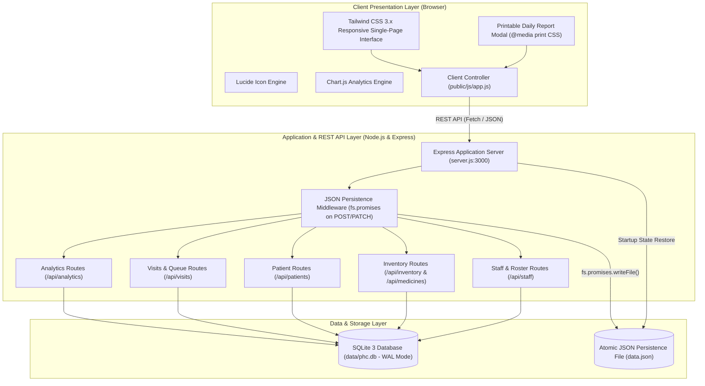

# Primary Health Centre (PHC) Monitoring and Management System

[](https://github.com)
[](https://github.com)
[](file:///d:/projects/SE%20SEM%20PHC/data.json)
[](http://localhost:3000)

> **Academic Submission:** U23IT481 - Software Engineering Laboratory  
> **Facility Profile:** PHC Ramapuram Health Complex (`PHC-TN-402`)  
> **Administrative Scope:** Directorate of Public Health & Family Welfare, National Health Mission (NHM), Tamil Nadu  

---

## 📋 Table of Contents
1. [Problem Statement & Overview](#-problem-statement--overview)
2. [Key Capabilities & Milestones](#-key-capabilities--milestones)
3. [System Architecture Diagram](#-system-architecture-diagram)
4. [Clinical Triage & Patient Workflow Diagram](#-clinical-triage--patient-workflow-diagram)
5. [Tech Stack](#-tech-stack)
6. [Setup & Installation Instructions](#-setup--installation-instructions)
7. [REST API Documentation](#-rest-api-documentation)
8. [Persistence Engine (`data.json` + SQLite)](#-persistence-engine-datajson--sqlite)
9. [Print / Export Daily PHC Report](#-print--export-daily-phc-report)
10. [Lab Evaluation Demo Checklist](#-lab-evaluation-demo-checklist)

---

## 🏥 Problem Statement & Overview

Primary Health Centres (PHCs) are the foundational backbone of India's rural and semi-urban public healthcare infrastructure under the National Health Mission (NHM). However, manual record keeping often causes severe administrative challenges:
- **Uncontrolled Queues:** Inability to track patient progression through triage, doctor consultation, and pharmacy dispensing in real time.
- **Stockouts of Essential Drugs:** Critical medicines (such as ORS, Paracetamol, Amoxicillin, Antimalarials, and Iron & Folic Acid) fall below minimum safety thresholds without automated reorder warnings.
- **Shift & Duty Gaps:** Lack of live visibility into active 24x7 medical, nursing, and pharmacy personnel on duty.
- **Fragmented Health Programs:** Disjointed tracking between general Outpatient care, Maternal Healthcare (ANC/PNC), Child Immunization, and Communicable Disease surveillance.

The **PHC Monitoring & Management System** solves these challenges by providing a unified, responsive single-page operational console backed by an asynchronous REST API and dual-layer data persistence.

---

## 🚀 Key Capabilities & Milestones

| Component / Sub-Task | Functionality & Implementation Details |
| :--- | :--- |
| **1. Live Executive KPI Cards** | Live counters for Total Daily Visits, Low Stock Medicine Alerts, Active On-Duty Staff, and Maternal & Child Care Consultations. Automatically synchronized with zero page reloads. |
| **2. One-Click Patient Triage Queue** | Filterable table showing active patients, tokens, and vital signs with instant one-click status transitions (`Waiting` $\rightarrow$ `In Consultation` $\rightarrow$ `Completed`). |
| **3. Medicine Inventory & Alerts** | Dynamic stock monitoring panel displaying batch numbers, expiry dates, visual warning badges (`LOW STOCK`, `EXPIRING SOON`), and one-click `+50` reorder / `-10` dispense adjustment buttons. |
| **4. Staff Duty Roster Toggler** | Personnel management table with one-click toggle between `On Duty` and `Off Duty`, instantly updating facility coverage indicators. |
| **5. Patient Registration Modal** | Registration modal capturing demographic data, contact info, clinical vitals (BP, Pulse, Temp, SpO2), and programmatic parameters (e.g. Trimester, EDD, High-Risk pregnancy flags). |
| **6. JSON File Persistence (Phase 5)** | Dual persistence mechanism using `fs.promises` in `server.js` to mirror all mutations to `data.json` on every `POST`/`PATCH` request, with automatic state restoration across server restarts. |
| **7. Official Printable Daily Report (Phase 5)** | Header-integrated `Export Daily PHC Report` modal formatting KPIs, footfall statistics, low-stock pharmacy audit items, and MOIC seal block into a clean `@media print` CSS view. |

---

## 🏛 System Architecture Diagram



---

## 🔄 Clinical Triage & Patient Workflow Diagram

```mermaid
stateDiagram-v2
    [*] --> PatientRegistration: Patient Arrival at PHC Front Desk
    
    state PatientRegistration {
        Demographics: Name, Age, Gender, Contact, Address
        ProgramSelection: Outpatient / Maternal Care / Child Immunization / Disease Prevention
        VitalsIntake: BP, Pulse, Body Temp, SpO2
    }

    PatientRegistration --> TokenIssued: UHID & Queue Token Assigned
    TokenIssued --> WaitingQueue: Added to Live Triage Queue

    state WaitingQueue {
        status: Waiting
        tag: Amber Badge
    }

    WaitingQueue --> DoctorConsultation: Doctor clicks "Start Consultation"
    
    state DoctorConsultation {
        status: In Consultation
        tag: Blue Badge
        Action: Clinical Examination & Diagnosis
    }

    DoctorConsultation --> PharmacyDispensation: Doctor Prescribes Medicines & clicks "Complete"
    
    state PharmacyDispensation {
        status: Completed / Pharmacy
        tag: Emerald Badge
        Action: Pharmacist dispenses drugs (-10 stock button)
    }

    PharmacyDispensation --> [*]: Patient Discharged & Database + data.json Persisted
```

---

## 🛠 Tech Stack

- **Backend Framework:** Node.js (v18+) with Express.js
- **Database Engine:** SQLite3 with WAL (Write-Ahead Logging) via `better-sqlite3`
- **File Persistence:** Node.js `fs.promises` atomic JSON serializer (`data.json`)
- **Frontend UI:** Vanilla HTML5, Tailwind CSS 3 (utility-first responsive framework)
- **Component Icons:** Lucide Icons CDN
- **Visual Analytics:** Chart.js 4.x
- **Cross-Origin Security:** CORS enabled

---

## ⚙ Setup & Installation Instructions

### Prerequisites
- Node.js (v18.0.0 or higher)
- npm (v9.0.0 or higher)
- Web Browser (Chrome, Firefox, Edge, or Safari)

### 1. Clone or Extract Project
```bash
git clone https://github.com/your-username/phc-monitoring-system.git
cd "d:/projects/SE SEM PHC"
```

### 2. Install Project Dependencies
```bash
npm install
```

### 3. Initialize & Seed Database
Seeds 12 realistic Indian demographic patients, 16 essential NHM medicines, 8 staff members, and active duty rosters:
```bash
npm run seed
```

### 4. Start the Application Server
```bash
npm start
```
*The server will start listening on `http://localhost:3000` and immediately synchronize `data.json`.*

### 5. Open Web Console
Open your browser and navigate to:
```
http://localhost:3000
```
*(Also accessible at `http://localhost:3000/phc.html`)*

---

## 📡 REST API Documentation

### 1. Executive Analytics & Dashboard
#### `GET /api/dashboard`
Returns live operational KPIs and threshold breach metrics.
- **Response `200 OK`**:
```json
{
  "status": "success",
  "data": {
    "today_visits": 12,
    "active_queue": 6,
    "completed_visits": 6,
    "low_stock_count": 5,
    "expiring_soon_count": 3,
    "on_duty_staff": 6,
    "high_risk_maternal": 2,
    "outbreak_alerts": 1
  }
}
```

---

### 2. Patient Registration & Triage Management
#### `GET /api/visits?today=true`
Retrieves patient queue for today with vitals, status, and program category.

#### `POST /api/patients`
Registers a new patient and generates an active visit token.
- **Request Body**:
```json
{
  "full_name": "Meena Kumari",
  "age": 28,
  "gender": "Female",
  "contact": "+91 94123 45688",
  "address": "South Block, Ward 6",
  "program_category": "Maternal Care",
  "symptoms": "2nd Trimester Routine Checkup",
  "bp": "118/76",
  "pulse": 78,
  "temp": 98.4,
  "spo2": 99,
  "meta_trimester": "2nd Trimester (24w)",
  "meta_high_risk": false
}
```
- **Response `201 Created`**:
```json
{
  "status": "success",
  "message": "Patient registered successfully",
  "data": { "patient_id": 13, "visit_id": 13, "uhid": "PHC-2026-013", "token_number": 13 }
}
```

#### `PATCH /api/patients/:id`
Updates clinical triage stage (`Waiting` $\rightarrow$ `In Consultation` $\rightarrow$ `Completed`) or diagnosis notes.
- **Request Body**:
```json
{
  "status": "In Consultation",
  "diagnosis": "Mild Gestational Anemia",
  "doctor_notes": "Prescribed IFA tablets 100mg daily"
}
```

---

### 3. Medicine Inventory Management
#### `GET /api/inventory`
Returns all medicines in stock, batches, expiry dates, and threshold status.

#### `PATCH /api/medicines/:id`
Adjusts inventory stock (+50 restock or -10 dispensation).
- **Request Body**:
```json
{
  "action": "adjust",
  "delta": -10,
  "reason": "OPD Dispensing"
}
```
- **Response `200 OK`**:
```json
{
  "success": true,
  "message": "Stock updated successfully for Paracetamol 500mg",
  "data": { "id": 1, "name": "Paracetamol 500mg", "quantity": 15, "min_threshold": 50, "status": "LOW STOCK" }
}
```

---

### 4. Staff Duty Roster
#### `GET /api/staff`
Returns all registered medical personnel and their active shift allocations.

#### `PATCH /api/staff/:id`
Toggles staff member duty status between `On Duty` and `Off Duty`.
- **Request Body**:
```json
{
  "duty_status": "Off Duty"
}
```

---

### 5. Snapshot Data Export
#### `GET /api/data.json`
Directly serves the latest persisted JSON database backup containing all tables and metadata.

---

## 💾 Persistence Engine (`data.json` + SQLite)

To satisfy the stringent requirements of lab demonstration readiness:
1. **Mutation Hook:** An Express middleware in [`server.js`](file:///d:/projects/SE%20SEM%20PHC/server.js) intercepts all `POST`, `PATCH`, `PUT`, and `DELETE` requests.
2. **Atomic Serialization:** Upon response completion (`res.on('finish')`), `persistDbToJson()` serializes the entire SQLite state (patients, visits, program_details, medicines, prescriptions, staff, duty_roster) to [`data.json`](file:///d:/projects/SE%20SEM%20PHC/data.json) using `fs.promises.writeFile`.
3. **Restart Survivability:** On server startup, `restoreDbFromJsonIfEmpty()` checks if the database is unseeded or clean. If `patients` table has 0 records, it restores all data structures from [`data.json`](file:///d:/projects/SE%20SEM%20PHC/data.json).

---

## 🖨 Print / Export Daily PHC Report

Healthcare authorities (District Health Officers, NHM Evaluators) require consolidated daily governance summaries:
1. Click the **"Export Daily PHC Report"** button in the top navigation bar.
2. The modal formats live data into the official Directorate of Public Health & Family Welfare audit standard:
   - Official Government Emblem & Facility Code (`PHC-TN-402`)
   - Executive 4-Pillar KPI counters
   - Health Program Footfall Distribution breakdown
   - Critical Low-Stock & Expiring Pharmacy Audit items with action tags
   - Active Medical & Nursing Duty Roster deployment
   - Medical Officer In-Charge (MOIC) signature, registration number, and seal block
3. Click **"Print / Save as PDF"** or trigger browser `Ctrl+P` to output a clean, background-free printable document.

---

## 🧪 Lab Evaluation Demo Checklist

Follow these exact steps during your practical demonstration:

1. **Verify Live Dashboard:**
   - Open `http://localhost:3000`.
   - Observe 4 KPI cards: Total Visits, Low Stock Alerts, Active Staff, Maternal & Child Care.
2. **Test Patient Triage Progression:**
   - Locate a patient with status `Waiting` in the Patient Queue table.
   - Click **"Start Consultation"** $\rightarrow$ Status changes instantly to `In Consultation`.
   - Click **"Complete"** $\rightarrow$ Status changes to `Completed`.
3. **Register New Patient Visit:**
   - Click **"Register New Patient Visit"** button in header.
   - Select program: `Maternal Care`. Fill in Trimester and check "Flag as High-Risk Pregnancy".
   - Click **"Register Patient"** $\rightarrow$ Queue updates instantly and Maternal KPI increments.
4. **Test Medicine Stock Alert:**
   - Scroll to Medicine Inventory. Locate an item close to minimum threshold.
   - Click `-10` until quantity drops below threshold $\rightarrow$ Red `LOW STOCK` badge triggers and header Low Stock KPI counter increments.
   - Click `+50` $\rightarrow$ Stock is replenished and alert clears.
5. **Test Staff Duty Toggler:**
   - Scroll to Staff Duty Roster.
   - Click the duty toggle button on a staff member (`On Duty` $\rightarrow$ `Off Duty`) $\rightarrow$ Active Staff KPI counter decrements dynamically.
6. **Export Daily Report:**
   - Click **"Export Daily PHC Report"** in header.
   - Verify all 5 audit sections and click "Print / Save as PDF".
7. **Verify Server Restart Survivability:**
   - Stop server (`Ctrl+C` in terminal).
   - Start server (`node server.js`).
   - Refresh browser $\rightarrow$ All created patients, modified stocks, and toggled duty statuses persist intact from `data.json`.

---

*Authored for U23IT481 - Software Engineering Laboratory.*
